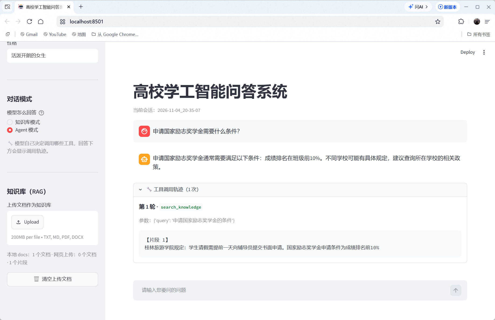

# 🎓 高校学工智能问答系统 (Student-Affairs-AI-Agent)

基于 LangChain 与智谱 GLM 大模型二次开发的垂直领域 RAG + Agent 智能问答系统。本项目针对高校学工手册查阅繁琐、大模型易产生“幻觉”的痛点，实现了基于本地知识库的精准问答与工具调用闭环。

## 🌟 核心亮点

- **防幻觉优化（Prompt 优化）**：针对 Agent 模式容易脱离文档“瞎编”的问题，设计了强约束提示词（System Prompt），强制模型优先调用知识库检索工具，大幅提升回答准确率。
- **Agent 工具调度**：实现了基于 Function Calling 的智能体架构，模型可自主判断是否需要查知识库、获取当前时间或进行数学计算。
- **本地化与持久化**：接入本地 HuggingFace Embeddings 向量模型与 Chroma 数据库，实现零成本运行与文档持久化加载。

## 🛠️ 技术栈

- **前端界面**：Streamlit
- **核心框架**：LangChain, Agent Tool Calling
- **大语言模型**：智谱 GLM-4-Flash API
- **向量检索**：HuggingFace, Chroma DB

## 📸 效果演示

## 🚀 本地运行指南

1. 克隆仓库：
   `git clone https://github.com/Allen-Lee03/Student-Affairs-AI-Agent.git`
2. 安装依赖：
   `pip install -r requirements.txt`
3. 配置 API Key：复制 `.env.example` 为 `.env`，并填入你的智谱 `ZHIPU_API_KEY`。
4. 启动应用：
   `streamlit run app.py`